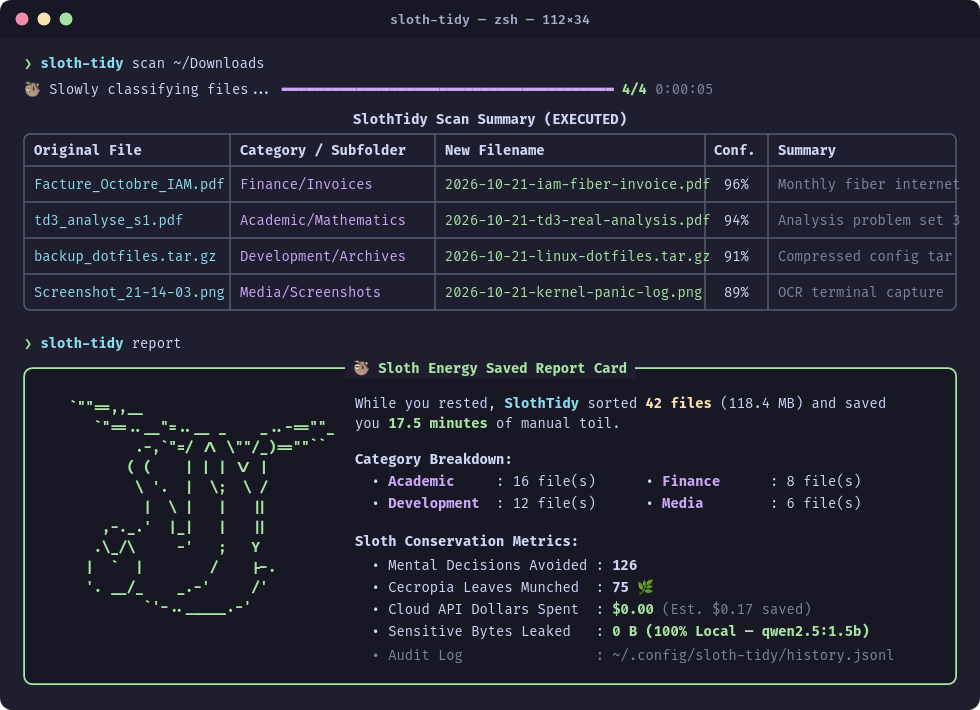
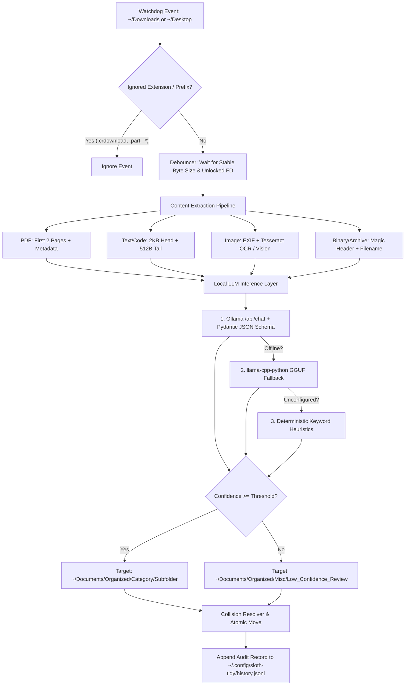

<div align="center">

<pre align="center">
`""==,,__&#160;&#160;&#160;&#160;&#160;&#160;&#160;&#160;&#160;&#160;&#160;&#160;&#160;&#160;&#160;&#160;&#160;&#160;&#160;&#160;&#160;&#160;&#160;
&#160;&#160;&#160;`"==..__"=..__ _    _..-==""_
&#160;&#160;&#160;&#160;&#160;&#160;&#160;&#160;.-,`"=/ /\ \""/_)==""``&#160;
&#160;&#160;&#160;&#160;&#160;&#160;&#160;( (    | | | \/ |&#160;&#160;&#160;&#160;&#160;&#160;&#160;&#160;
&#160;&#160;&#160;&#160;&#160;&#160;&#160;&#160;\ '.  |  \;  \ /&#160;&#160;&#160;&#160;&#160;&#160;&#160;&#160;
&#160;&#160;&#160;&#160;&#160;&#160;&#160;&#160;&#160;|  \ |   |   ||&#160;&#160;&#160;&#160;&#160;&#160;&#160;&#160;
&#160;&#160;&#160;&#160;,-._.'  |_|   |   ||&#160;&#160;&#160;&#160;&#160;&#160;&#160;&#160;
&#160;&#160;&#160;.\_/\     -'   ;   Y&#160;&#160;&#160;&#160;&#160;&#160;&#160;&#160;&#160;
&#160;&#160;|  `  |        /    |-.&#160;&#160;&#160;&#160;&#160;&#160;&#160;
&#160;&#160;'. __/_    _.-'     /'&#160;&#160;&#160;&#160;&#160;&#160;&#160;&#160;
&#160;&#160;&#160;&#160;&#160;&#160;&#160;&#160;&#160;`'-.._____.-'&#160;&#160;&#160;&#160;&#160;&#160;&#160;&#160;&#160;&#160;
</pre>

# 🦥 SlothTidy

**Zero-friction, privacy-first local AI file organization daemon.**  
*Built for the Hacktoberfest 2026 "Slow and Steady" Challenge.*

[](https://www.python.org/)
[](https://ollama.com/)
[](https://docs.pydantic.dev/)
[](LICENSE)
[](https://hacktoberfest.com/)

</div>
</div>

---

## 🌿 The Sloth Ethos

Sloths survive by conserving energy. You shouldn't spend yours manually renaming `scan_0042 (1).pdf` or dragging screenshots out of `~/Downloads`.

**SlothTidy** runs quietly in the background, watches your `~/Downloads` and `~/Desktop` folders, extracts lightweight context once downloads finish writing, and uses a small open-weight language model (`qwen2.5:1.5b` or `llama3.2:1b`) running **100% locally on your CPU** to categorize, rename (`YYYY-MM-DD-descriptive-slug.ext`), and file everything into `~/Documents/Organized`.

- **Total Privacy**: Bank statements, tax records, national IDs, and source code never leave `localhost`.
- **Zero API Costs**: Powered by local **Ollama** or **llama-cpp-python** GGUF models.
- **Zero Data Loss**: Never overwrites existing files, isolates low-confidence guesses, and logs every move to `~/.config/sloth-tidy/history.jsonl` for instant `sloth-tidy undo` rollbacks.

---

## 📸 Terminal Demo

<p align="center">
  
</p>

> *Above: Running `sloth-tidy scan ~/Downloads` to classify incoming PDFs, archives, and screenshots via local `qwen2.5:1.5b`, followed by `sloth-tidy report` to inspect the Sloth Energy Saved Report Card.*

---

## ✨ Key Features

* **Debounced Non-Blocking Daemon (`watchdog`)**: Automatically ignores browser partial writes (`.crdownload`, `.part`, `.tmp`, `.aria2`) and waits until file byte sizes stabilize and POSIX file locks (`fcntl.flock`) release before inspecting content.
* **Grammar-Enforced Structured Output (`Pydantic v2`)**: Passes strict JSON schemas directly into Ollama's `/api/chat` `format` constraint, guaranteeing valid categories, sanitized relative subfolders, and normalized `YYYY-MM-DD` kebab-case filenames.
* **3-Tier Local Inference Fallback**:
  1. **Primary**: Local Ollama REST endpoint (`http://localhost:11434`) with exponential backoff retries.
  2. **Secondary**: Native `llama-cpp-python` GGUF bindings (`gguf_fallback_path`).
  3. **Safety Net**: Deterministic keyword & extension heuristics if local LLM services are offline.
* **Multi-Format Content Extraction**:
  * **PDFs**: First 2 pages of text + document metadata (`/Title`, `/Author`, `/Subject`) via `pypdf`.
  * **Source Code & Text**: First 2 KB (head) and last 512 B (tail) with UTF-8 heuristic detection.
  * **Images & Screenshots**: Resolution + EXIF tags via `Pillow`, local OCR via `pytesseract`, and optional Base64 thumbnails for local vision models (`moondream:latest`).
  * **Binaries & Archives**: 8-byte magic header + filename reasoning without reading heavy binary buffers into RAM.
* **Collision-Safe Atomic Moves & Undo**: Appends `-1`, `-2` on filename collisions (preserving compound extensions like `.tar.gz`) and supports multi-step rollbacks.

---

## 🏗️ Architecture



---

## 🚀 Quickstart

### 1. Prerequisites

Install [Ollama](https://ollama.com/) and pull a lightweight CPU-friendly model:

```bash
ollama pull qwen2.5:1.5b
# Or for an even smaller RAM footprint (~1.3 GB):
ollama pull llama3.2:1b
```

*(Optional)* Install **Tesseract OCR** if you want SlothTidy to read text inside screenshots and scanned images:

```bash
# Arch Linux
sudo pacman -S tesseract tesseract-data-eng tesseract-data-fra

# Ubuntu / Debian / Pop!_OS
sudo apt install tesseract-ocr

# macOS
brew install tesseract
```

*(Optional)* Pull **Moondream2** if you want local multimodal vision classification alongside OCR:

```bash
ollama pull moondream:latest
```

### 2. Installation

Clone the repository and install inside a Python 3.11+ virtual environment:

```bash
git clone https://github.com/tahaenasraoui-debug/sloth-tidy.git
cd sloth-tidy
python3 -m venv .venv
source .venv/bin/activate

# Standard install
pip install -e .

# Or install with dev dependencies (pytest) and optional llama-cpp-python support
pip install -e ".[dev,llama-cpp]"
```

---

## 🖥️ CLI Usage

### 1. Preview Organization with a Dry-Run Scan
Scan any directory and view the proposed categorization table without moving a single file:

```bash
sloth-tidy scan ~/Downloads --dry-run
```

### 2. Start the Background Daemon
Monitor `~/Downloads` and `~/Desktop` continuously in the background:

```bash
sloth-tidy run

# Or run in dry-run mode / override the active Ollama model:
sloth-tidy run --dry-run --model llama3.2:1b
```

### 3. View the Audit Log
Inspect recent file moves and their current status:

```bash
sloth-tidy history --limit 15
```

### 4. Undo Recent Moves
Changed your mind? Roll back the last `N` organized files to their exact original paths:

```bash
# Undo the last move
sloth-tidy undo

# Undo the last 5 moves
sloth-tidy undo 5
```

### 5. Print Your "Sloth Energy Saved" Report Card
See how much manual toil and cloud API spend the sloth has saved you:

```bash
sloth-tidy report
```

---

## ⚙️ Configuration

On first launch, SlothTidy generates `~/.config/sloth-tidy/config.toml` with sensible defaults:

```toml
watch_dirs = [
    "/home/user/Downloads",
    "/home/user/Desktop",
]
target_root = "/home/user/Documents/Organized"
ollama_endpoint = "http://localhost:11434"
model_name = "qwen2.5:1.5b"
vision_model_name = "moondream:latest"
confidence_threshold = 0.55
debounce_seconds = 2.5
max_text_bytes = 2048
enable_ocr = true
enable_vision_model = false
ignored_extensions = [
    ".crdownload",
    ".part",
    ".tmp",
    ".download",
    ".partial",
    ".swp",
    ".lock",
    ".aria2",
    ".ut!",
]
ignored_prefixes = [".", "~$", "__"]

# Optional path to a local GGUF file if you use llama-cpp-python without Ollama:
# gguf_fallback_path = "/home/user/.models/qwen2.5-1.5b-instruct-q4_k_m.gguf"
```

---

## 🧪 Running Tests

The test suite covers Pydantic JSON schema sanitization (including path-traversal prevention), compound extension collision resolution (`.tar.gz`), `--dry-run` isolation, and multi-step `undo` rollbacks:

```bash
pytest -v
```

---

## 📂 Project Structure

```text
sloth-tidy/
├── pyproject.toml           # Build configuration and pinned dependencies
├── README.md                # Project documentation
├── DEV_POST.md              # Hacktoberfest 2026 "Slow and Steady" article & benchmarks
├── assets/
│   └── image.png            # Terminal UI preview image (scan + report card)
├── sloth_tidy/
│   ├── __init__.py          # Package version metadata
│   ├── config.py            # TOML configuration loader & Pydantic settings validation
│   ├── extractors.py        # PDF, text, EXIF/OCR image, and binary magic-byte extractors
│   ├── llm.py               # Ollama client, llama.cpp fallback, and JSON schema contract
│   ├── organizer.py         # Collision resolver, atomic mover, and JSONL history manager
│   ├── watcher.py           # Debounced Watchdog daemon & POSIX file-lock checks
│   └── cli.py               # Typer + Rich CLI commands (run, scan, history, undo, report)
└── tests/
    └── test_organizer.py    # Automated pytest suite
```

---

## 🤝 Contributing

Contributions, issues, and feature requests are welcome for **Hacktoberfest 2026**!
1. Fork the repository.
2. Create a feature branch (`git checkout -b feat/custom-category-rules`).
3. Ensure all tests pass (`pytest -v`).
4. Open a Pull Request.

---

## 📄 License

Distributed under the **MIT License**. See `LICENSE` for more information.
